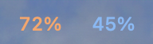
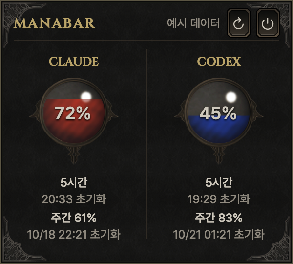

<h1 align="center">ManaBar</h1>

<p align="center">
  <strong>남은 AI 사용량을, 마나처럼.</strong><br>
  Claude Code와 Codex의 사용 여유와 초기화 시간을 확인하는 macOS 메뉴바 앱
</p>

<p align="center">
  
  
  
  <a href="LICENSE"></a>
</p>

<p align="center">
  <a href="#주요-기능">주요 기능</a> ·
  <a href="#로컬에서-실행">로컬에서 실행</a> ·
  <a href="#사용량과-연결">사용량과 연결</a> ·
  <a href="#문서와-라이선스">문서와 라이선스</a>
</p>

<p align="center">
  
  <br><sub>왼쪽 Claude · 오른쪽 Codex</sub>
</p>

<p align="center">
  
  <br><sub>두 화면은 앱의 미리보기 모드로 캡처했습니다. 72%·45% 등의 숫자는 실제 계정 데이터가 아닌 예시입니다.</sub>
</p>

## 주요 기능

| 메뉴바에서 빠르게 | 패널에서 자세히 |
| --- | --- |
| Claude·Codex 잔여 비율을 동시에 표시 | 서비스별 마나 구슬과 잔여 비율 |
| 주황색·파란색 숫자로 서비스 구분 | 5시간·주간 등 조회된 한도를 분리 |
| 오래된 값은 `*`로 표시 | 한도별 초기화 시각과 연결 상태 |
| 메뉴바 항목 하나로 접근 | 확인 시간 · 갱신 · 종료를 우측 상단에 배치 |

디아블로 1·2를 오마주한 레트로 다크 판타지 RPG 스타일입니다.
어두운 돌 배경, 금속 테두리, 낡은 금색 글자와 마나 구슬에 사용량을 담았습니다.

## 지원 환경

| 항목 | 지원 범위 |
| --- | --- |
| Mac | **Apple Silicon 전용 · arm64** |
| 운영체제 | macOS 13 이상 |
| Claude | Claude Code 설치 및 로그인 |
| Codex | Codex 앱 또는 CLI 설치 및 로그인 |
| 소스 빌드 | Swift 6를 지원하는 Xcode 개발 도구 |
| npm CLI | arm64 Node.js 22 이상과 npm |

## 로컬에서 실행

현재 npm 패키지는 **게시 보류 상태**입니다. 지금은 소스에서 빌드해 사용할 수 있습니다.

```sh
git clone https://github.com/icecokel/mana-bar.git
cd mana-bar
./scripts/build.sh
.build/ManaBar.app/Contents/MacOS/ManaBar --show-panel
```

빌드 결과는 `.build/ManaBar.app`에 생성됩니다. 메뉴바의 숫자를 누르면 상세 패널이 열립니다.

> **개발용 베타 안내**
>
> 현재 앱은 개발용 자체 서명을 사용하며 Apple 공증을 받지 않았습니다.
> 다른 Mac에서 다운로드한 앱을 실행하면 macOS가 경고하거나 차단할 수 있습니다.

### npm 배포 준비

사전 빌드한 앱과 실행용 CLI를 하나의 패키지로 묶습니다.
사용자 설치 과정에서 Swift를 컴파일하거나 별도 서버를 설치하지 않습니다.

```sh
npm run pack
```

현재 버전의 결과물은 `.build/mana-bar-0.1.0-beta.1.tgz`입니다.
패키지 파일 구성, 실행 권한, arm64 아키텍처, 앱 서명과 리소스를 검사합니다.
등록 절차는 [개발·배포 안내](scripts/DEVELOPMENT.txt), 배포 후 사용법은 [npm 패키지 안내](scripts/npm-README.md)를 참고하세요.

## 사용량과 연결

### Claude Code

Claude Code에 로그인한 뒤 패널의 **연결** 버튼으로 키체인 접근을 승인합니다.
현재 Mac의 `Claude Code-credentials`를 읽으며, 사용량 조회는 Claude Code의 비공개 엔드포인트에 의존합니다.
서비스 변경, 로그인 만료 또는 키체인 권한 변경으로 다시 연결해야 할 수 있습니다.
개발용 앱을 다시 빌드한 뒤에도 macOS가 승인을 다시 요청할 수 있습니다.

### Codex

설치된 Codex 앱 또는 CLI의 로컬 로그인으로 사용량을 조회합니다.
ManaBar가 조회에 필요한 로컬 프로세스를 실행하므로 별도 앱 서버를 세팅하거나 운영할 필요가 없습니다.

### 표시 원칙

- 메뉴바 숫자는 서비스가 제공한 **대표 한도의 잔여 비율**입니다. 상세 패널에서 해당 한도를 확인할 수 있습니다.
- 5시간·주간 등 다른 제한은 구분하며, 실제로 반환된 한도만 표시합니다.
- 연결이 없거나 조회에 실패하면 `—` 또는 오류를 표시합니다. 실패를 잔여량 `0%`로 바꾸지 않습니다.
- 마지막으로 확인한 값이 남아 있다면 오래된 값임을 따로 안내합니다.
- 두 서비스의 잔여량을 하나의 수치로 합산하지 않습니다.
- 계정 토큰·비밀번호·키체인은 배포 패키지에 포함하지 않습니다.

## 개발과 검사

```sh
# Swift 로직·표시 상태 + npm CLI 검사
npm test

# Swift 검사만 실행
./scripts/check.sh

# npm CLI 검사만 실행
npm run test:cli
```

화면 미리보기는 계정 조회 없이 확인할 수 있습니다.

```sh
.build/ManaBar.app/Contents/MacOS/ManaBar --preview
```

## 문서와 라이선스

- [초기 컨셉과 목적](docs/CONCEPT.md)
- [개발·서명·배포 안내](scripts/DEVELOPMENT.txt)
- [npm 패키지 안내](scripts/npm-README.md)
- [아트워크·폰트 출처](Assets/CREDITS.txt)
- [MIT 라이선스](LICENSE)

앱과 CLI는 MIT 라이선스입니다. 동봉한 아트워크는 CC0, Cinzel·Pretendard 글꼴은 SIL Open Font License를 따릅니다.
ManaBar는 개인 프로젝트이며 Anthropic·OpenAI·Blizzard의 공식 앱이 아닙니다.
